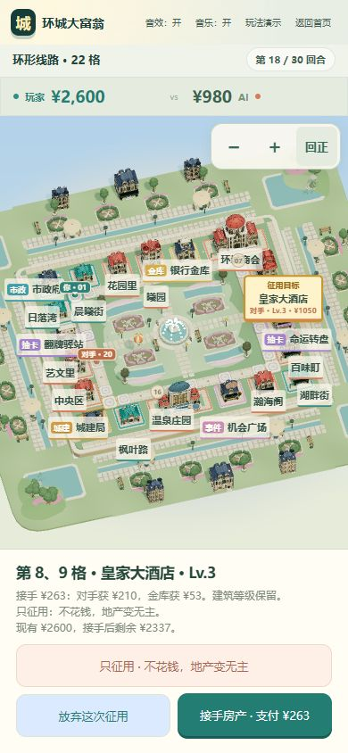

# 建筑构件清理与征用交互验收

2026-10-25；基准提交 64048249925d7c3484a826558a194a9546d01a2a。

复查五图 145 栋常规/功能建筑和 2 栋外围地标，共 147 件；定向修复 57 件。区域改动数量：{"classic":4,"compact":3,"expansion":4,"harbor":17,"alpine":29}。未调用生图或 AI 建模，京都 villa_2 基准保持原字节。

- 清理叠加拱架、被遮挡却漏出的旧窗、重复小窗及穿插碎块。
- 约束阿尔卑斯百叶窗与相邻门窗/墙角的间距，修复灯穿雨棚、告示板盖窗和悬空柱脚。
- 主楼造型和满级体量保留；两座传送门移除越界窗饰后自动适配高度增约 1.08%。
- 11 个受影响远景模型同步更新；五图资源包及 145 张游戏预览已发布。

征用改为地图下方面板，可拖动旋转、缩放、点选地图或列表目标；双格地产显示两个格号并持续高亮。报价保持浏览角度，退出恢复原跟随视角。名称调整为环城商会、皇家大酒店、都会大酒店，金额与原收益规则不变。

资产校验、105 个屋顶归属版本、40 栋功能建筑、9,234 次落脚避让检查通过；24,624 条视线中有 7 条边缘遮挡，头胸中心无阻挡。详细数据见 [audit.json](audit.json) 和 [sightlines.json](sightlines.json)。

对照图左为修前、右为修后：[建筑对照](comparison.jpg)。竖屏验收是 390×844 浏览器视口，不代表实体手机帧率测试。

50 条征用界面流程、26 条原有征用规则、5 图镜头与 7,524 帧路线跟随测试通过。包含征用期间打开“返回首页”后取消的状态恢复。

